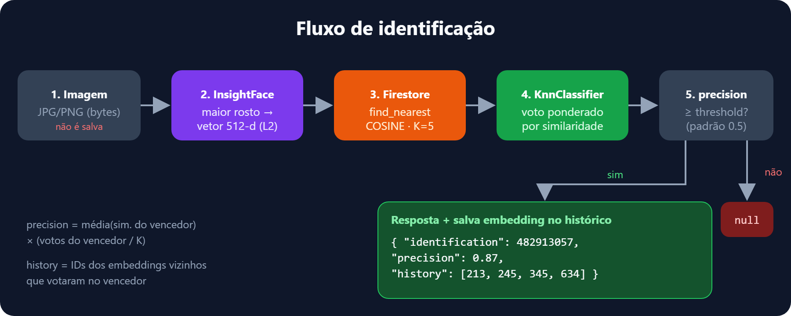
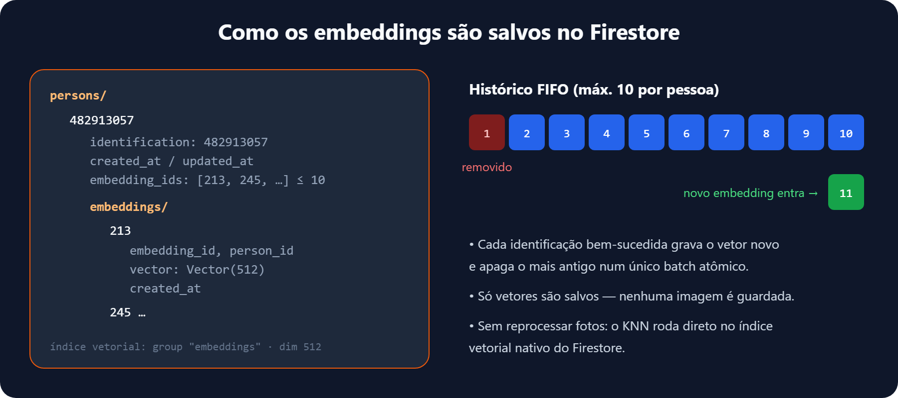
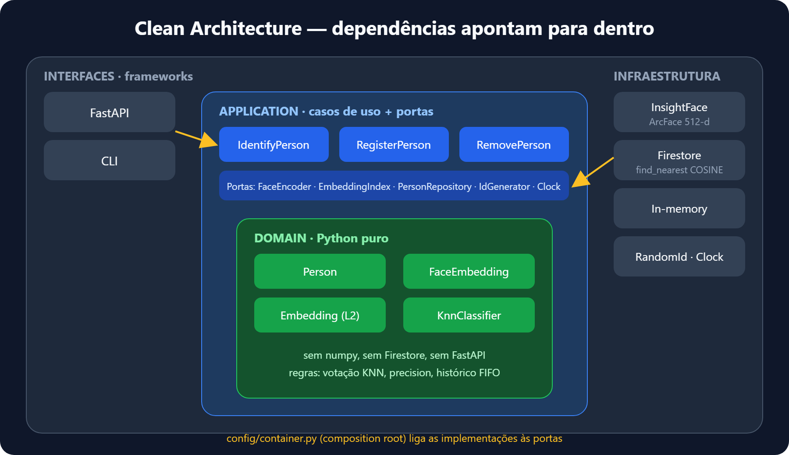

<div align="center">

# 👁️ booprecognition

**Motor agnóstico de reconhecimento facial em Python**<br>
Embeddings ArcFace · KNN vetorial no Firestore, MongoDB **ou** SQLite · Clean Architecture

<p>
  
  
  
  
  
  
</p>

</div>

<table>
<tr>
<td width="33%" valign="top">

### 🔒 Sem imagens
Só o **vetor** do rosto (1024 números) é salvo. A foto é descartada logo depois do processamento.

</td>
<td width="33%" valign="top">

### ⚡ Sem reprocessar
O KNN roda direto no **índice vetorial nativo** do banco (Firestore, MongoDB ou SQLite). Nenhuma foto antiga precisa ser lida de novo.

</td>
<td width="33%" valign="top">

### 🧩 Agnóstico
Modelo, banco e framework ficam atrás de **portas**. Trocar qualquer um deles exige só um novo adaptador.

</td>
</tr>
</table>

---

## 📤 Resposta

```json
{
  "identification": 482913057,
  "precision": 0.87,
  "history": [213, 245, 345, 634, 346]
}
```

| Campo | Significado |
|---|---|
| `identification` | ID aleatório de 9 dígitos da pessoa |
| `precision` | `0–1`: similaridade média dos vizinhos vencedores × fração dos K votos |
| `history` | IDs dos embeddings vizinhos que sustentaram a conclusão |

---

## 🛠️ Os 3 serviços

<table>
<tr><th>Serviço</th><th>HTTP</th><th>CLI</th><th>O que faz</th></tr>
<tr>
<td>🔍 <b>Identificar</b></td>
<td><code>POST /identify</code></td>
<td><code>booprecognition identify foto.jpg</code></td>
<td>Retorna a pessoa ou <code>null</code>. Se encontrar, guarda o novo embedding no histórico (máx. 10; o mais antigo sai).</td>
</tr>
<tr>
<td>➕ <b>Cadastrar</b></td>
<td><code>POST /persons</code></td>
<td><code>booprecognition register foto.jpg</code></td>
<td>Verifica antes se a pessoa existe. Se existir, devolve <code>200</code> com <code>created: false</code>; senão cria e devolve <code>201</code> com o header <code>Location</code>. Nos dois casos o corpo traz o <code>id</code> da pessoa.</td>
</tr>
<tr>
<td>🗑️ <b>Remover</b></td>
<td><code>DELETE /persons/{id}</code></td>
<td><code>booprecognition remove 482913057</code></td>
<td>Apaga a pessoa e todos os seus embeddings (<code>404</code> se não existir).</td>
</tr>
</table>

Os uploads usam multipart com o campo `image`. Erros: `422` quando não há rosto ou a imagem é inválida, `404` quando a pessoa não existe.

---

## 🔑 Autenticação (OAuth 2.0 + JWT)

Todas as rotas HTTP exigem um **access token JWT** obtido pelo grant OAuth 2.0 `client_credentials` em `POST /oauth/token`.

```bash
# 1. Pegar o token (credenciais via Basic auth ou nos campos client_id/client_secret)
curl -u boop-admin:$BOOP_CLIENT_ADMIN_SECRET -d grant_type=client_credentials http://localhost:8000/oauth/token
# {"access_token":"eyJ...","token_type":"Bearer","expires_in":3600,"scope":"identify persons:delete persons:write"}

# 2. Usar o token
curl -H "Authorization: Bearer eyJ..." -F image=@foto.jpg http://localhost:8000/identify
```

| Escopo | Rota |
|---|---|
| `identify` | `POST /identify` |
| `persons:write` | `POST /persons` |
| `persons:delete` | `DELETE /persons/{id}` |

Todos os exemplos de `curl` estão em [`docs/api-curl.md`](docs/api-curl.md). Peça só parte dos escopos com `scope=identify`. Respostas: `401` para token ausente, inválido ou expirado; `403` para escopo insuficiente. Os erros do `/oauth/token` seguem o RFC 6749 (`invalid_client`, `invalid_scope`, `unsupported_grant_type`).

Os clientes ficam em `auth.clients` no `config.yaml`. O `client_secret` de cada um e a chave de assinatura (`BOOP_JWT_SECRET`, mínimo 32 bytes) vêm de variáveis de ambiente. Para desenvolvimento local, `auth.enabled: false` desliga a autenticação.

---

## 🔄 Como funciona a identificação



1. A imagem chega em bytes e **não é salva**.
2. O **SCRFD-10G** detecta o maior rosto e dois modelos ArcFace (**buffalo_l** R50 e **antelopev2** R100) geram 512 dimensões cada; os blocos são normalizados e concatenados (1024-d). Veja [docs/reconhecimento-facial.md](docs/reconhecimento-facial.md).
3. O banco escolhido em `target` devolve os K=5 vetores mais próximos por cosseno: `find_nearest` no **Firestore** `$vectorSearch` no **MongoDB** ou cosseno vetorizado no **SQLite**.
4. O **KnnClassifier** soma os votos de cada pessoa, ponderados pela similaridade.
5. Se `precision ≥ threshold`, responde e grava o vetor novo no histórico; senão retorna `null`.

> ⚠️ **Migração para o ensemble (1024-d):** vetores antigos de 512-d (só buffalo_l) não são comparáveis. Limpe as coleções/tabelas de embeddings, recrie o índice vetorial com 1024 dimensões e recadastre as pessoas.

---

## 💾 Como os embeddings são salvos



### 🔥 No Firestore

```
persons/{personId}
 ├─ identification, created_at, updated_at
 ├─ embedding_ids: [213, 245, …]          ← ordem do mais antigo ao mais novo, ≤ 10
 └─ embeddings/{embeddingId}
     ├─ embedding_id, person_id
     ├─ vector: Vector(1024)              ← único dado biométrico guardado
     └─ created_at
```

<details>
<summary><b>Por que guardar até 10 embeddings por pessoa?</b></summary>

<br>
Cada identificação acrescenta um vetor recente da pessoa, com outra luz, outro ângulo ou outra idade, e isso deixa as próximas buscas mais precisas. Com o limite em 10, o custo fica previsível: quando entra o 11º, o mais antigo é apagado **no mesmo batch atômico** (`append_embedding`).
</details>

<details>
<summary><b>Criar o índice vetorial (obrigatório)</b></summary>

```bash
gcloud firestore indexes composite create --collection-group=embeddings --query-scope=COLLECTION_GROUP --field-config=field-path=vector,vector-config='{"dimension":"1024","flat":"{}"}'
```
Crie um índice para cada nome de coleção de embeddings (por exemplo `embeddings_it`, usado nos testes de integração).
</details>

### 🍃 No MongoDB

```
boop-persons             { _id: personId, identification, created_at, updated_at, embedding_ids[≤10] }
boop-embeddings-history  { _id: embeddingId, embedding_id, person_id, vector: [1024 floats], created_at }
```

O mesmo FIFO vale aqui: inserir o novo, apagar o mais antigo e atualizar a pessoa acontecem numa **transação** (`use_transactions: true`, exige replica set ou Atlas).

<details>
<summary><b>Índice de busca vetorial do MongoDB</b></summary>

Na inicialização, o motor cria o índice `person_id` e, no modo `atlas`, o índice de busca vetorial abaixo (se ainda não existir):

```json
{
  "name": "boop_vector_index",
  "type": "vectorSearch",
  "definition": {
    "fields": [
      { "type": "vector", "path": "vector", "numDimensions": 1024, "similarity": "cosine" },
      { "type": "filter", "path": "person_id" }
    ]
  }
}
```
O `$vectorSearch` funciona no **MongoDB Atlas** e no **Community 8.2+ com mongot**. Num Mongo local sem busca vetorial, use `vector_search.mode: brute_force`: a similaridade é calculada em Python e serve só para desenvolvimento ou poucos dados.
</details>

### 🪶 No SQLite (local)

Um único arquivo, sem servidor nem credencial:

```sql
boop_persons            (identification PK, created_at, updated_at, embedding_ids JSON ≤ 10)
boop_embeddings_history (embedding_id PK, person_id FK ON DELETE CASCADE, vector BLOB float32, dimension, created_at)
```

- O FIFO roda dentro de uma transação (`BEGIN IMMEDIATE`). Remover a pessoa apaga os embeddings dela em cascata.
- Modo WAL com `busy_timeout`, seguro para as requisições concorrentes do FastAPI.
- `vector_search.mode`:
  - `brute_force` (padrão): matriz numpy em memória e cosseno vetorizado; atende bem algumas dezenas de milhares de embeddings.
  - `sqlite_vec`: extensão [sqlite-vec](https://github.com/asg017/sqlite-vec) (`pip install -e ".[sqlite-vec]"`), para bases maiores.

---

## 🏛️ Arquitetura



<table>
<tr><th>Camada</th><th>Pasta</th><th>Responsabilidade</th><th>Depende de</th></tr>
<tr><td>🟢 Domain</td><td><code>domain/</code></td><td>Entidades, <code>Embedding</code>, <code>KnnClassifier</code>, regra FIFO</td><td>nada</td></tr>
<tr><td>🔵 Application</td><td><code>application/</code></td><td>Casos de uso, portas (<code>Protocol</code>) e DTOs</td><td>Domain</td></tr>
<tr><td>⚙️ Infrastructure</td><td><code>infrastructure/</code></td><td>InsightFace, Firestore, MongoDB, SQLite, in-memory, IDs</td><td>Application, Domain</td></tr>
<tr><td>🌐 Interfaces</td><td><code>interfaces/</code></td><td>FastAPI e CLI: só traduzem a entrada e a saída</td><td>Application</td></tr>
<tr><td>🔌 Config</td><td><code>config/</code></td><td><code>config.yaml</code> → <code>Settings</code> e <code>container.py</code> (escolhe o banco pelo <code>target</code>)</td><td>todas</td></tr>
</table>

> **Trocar uma peça:** escreva uma classe que implemente a porta (por exemplo outro `FaceEncoder` ou um `PersonRepository` em Postgres) e registre-a em `config/container.py`. Domínio e casos de uso não mudam.

---

## 🚀 Começando

```bash
py -m venv .venv
.venv/Scripts/python -m pip install -e ".[all,dev]"
cp .env.example .env      # só os segredos
.venv/Scripts/booprecognition serve
```

> 💻 **Rodar 100% local, sem nuvem:** `BOOP_TARGET=sqlite .venv/Scripts/booprecognition serve`. Os dados ficam em `./data/booprecognition.db` e continuam lá depois de reiniciar.

### ⚙️ Configuração: `config.yaml`

Toda a configuração fica em [`config.yaml`](config.yaml), que pode ser trocado por outro arquivo com `BOOP_CONFIG=caminho.yaml`. A chave **`target`** escolhe o banco:

```yaml
target: firestore            # firestore | mongodb | sqlite | memory
project: booprecognition

setup-alg:
  knn_k: 5
  match_threshold: 0.5
  max_embeddings_person: 10
  min_top_similarity: 0.6
  min_margin: 0.1
  update_threshold: 0.7
  encoder_models: [buffalo_l, antelopev2]   # SCRFD-10G + ArcFace R50 + R100
  min_model_agreement: 0.5
  id_digits: 9

databases:
  firestore:
    project_id: booprecognition
    credentials_env: GOOGLE_APPLICATION_CREDENTIALS
    collections:
      persons: boop-persons
      embeddings: boop-embeddings-history

  mongodb:
    uri_env: BOOP_MONGODB_URI
    database: booprecognition
    collections:
      persons: boop-persons
      embeddings: boop-embeddings-history
    use_transactions: true
    vector_search:
      mode: atlas              # atlas | brute_force
      index_name: boop_vector_index
      num_candidates: 100

  sqlite:
    path: ./data/booprecognition.db
    path_env: BOOP_SQLITE_PATH
    tables:
      persons: boop_persons
      embeddings: boop_embeddings_history
    vector_search:
      mode: brute_force        # brute_force | sqlite_vec
      dimension: 1024           # 512 × modelos
```

<table>
<tr><th><code>target</code></th><th>Implementação</th><th>Autenticação (variável de ambiente)</th></tr>
<tr><td><code>firestore</code></td><td><code>FirestoreFaceRepository</code></td><td>a env nomeada em <code>credentials_env</code> aponta para a service account. Sem ela, usa as Application Default Credentials.</td></tr>
<tr><td><code>mongodb</code></td><td><code>MongoFaceRepository</code></td><td>a env nomeada em <code>uri_env</code> guarda a connection string (com usuário e senha). É obrigatória.</td></tr>
<tr><td><code>sqlite</code></td><td><code>SqliteFaceRepository</code></td><td>nenhuma: arquivo local em <code>path</code> (ou na env <code>path_env</code>)</td></tr>
<tr><td><code>memory</code></td><td><code>InMemoryFaceRepository</code></td><td>nenhuma (desenvolvimento e testes)</td></tr>
</table>

> 🔐 **Segredos nunca entram no YAML.** O arquivo guarda só o *nome* da variável de ambiente. Os valores vêm do ambiente ou de um `.env` local, que é carregado automaticamente e não sobrescreve variáveis já definidas.

<details>
<summary><b>Variáveis de ambiente</b></summary>

| Variável | Uso |
|---|---|
| `GOOGLE_APPLICATION_CREDENTIALS` | Caminho da service account do Firebase |
| `BOOP_MONGODB_URI` | Connection string do MongoDB |
| `BOOP_CONFIG` | Caminho alternativo para o `config.yaml` |
| `BOOP_SQLITE_PATH` | Caminho alternativo do arquivo SQLite |
| `BOOP_JWT_SECRET` | Chave de assinatura dos tokens JWT (≥ 32 bytes) |
| `BOOP_CLIENT_ADMIN_SECRET` | `client_secret` do cliente `boop-admin` (nome em `auth.clients[].secret_env`) |
| `BOOP_TARGET` | Sobrescreve o `target` do YAML (por exemplo em deploy ou CI) |
</details>

<details>
<summary><b>🧪 Testes</b></summary>

```bash
.venv/Scripts/python -m pytest
```
Integração com o banco do `target` e o modelo reais (precisa das variáveis `BOOP_TEST_FACE_A1`, `BOOP_TEST_FACE_A2` e `BOOP_TEST_FACE_B`):
```bash
.venv/Scripts/python -m pytest -m integration
```
</details>

<details>
<summary><b>🐳 Docker</b></summary>

```bash
docker build -t booprecognition .
```
</details>
